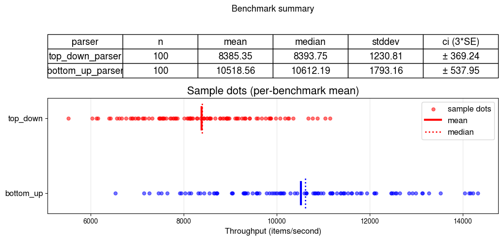

# Current performance of parser

## Test stand
   OS: Void Linux

   MACHINE: Linux schonfinkel x86_64 GNU/Linux

   CPU: Intel(R) Core(TM) i7-10510U CPU @ 1.80GHz

   OCAML NATIVE COMPILER: 5.5.1

   CPU TURBO: disabled

   GCC VERSION: gcc (GCC) 14.2.1 20250405
# Steps to generate plot
1) Make sure you are in this working directory (`cd benchmark`)
2) Run `dune exec ./gen_benchmarks.exe` to generate example with which you will benchmark parsers. They will be in `/examples` dir
2) Run `dune exec ./bench.exe` to run benchmarks.
## Make sure you are using best practices
- I like to use these commands before doing benchmarks:
``` bash
  # Fix the freq of cpu
  sudo cpupower frequency-set -g performance
  sudo cpupower frequency-set -d 800Mhz
  sudo cpupower frequency-set -u 4000Mhz
```
- Remove turbo (In my case i have intel CPU)
``` bash
echo "1" | sudo tee /sys/devices/system/cpu/intel_pstate/no_turbo
```

- Isolate 2 3 core as a linux kernel parameter
```
isolcpus=2,3
```

- Disable schedule-clock interupts
```
nohz_full=2,3
```

- Use isolated cpus
``` bash
taskset -c 2, 3 ./my-realtime-program
```
