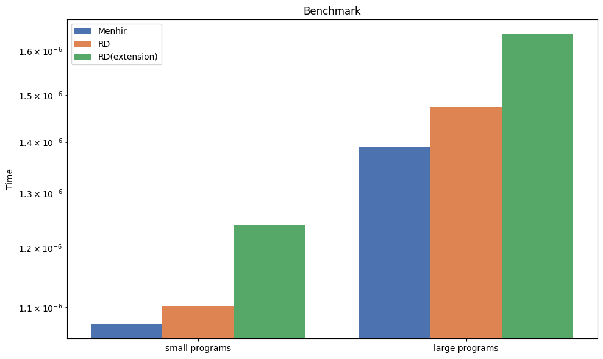

### Бенмарк 

##### [Код генератора](./generate.ml)
##### [Код замеров](./main.ml)

На сгенерированных с помощью QCheck данных (см. _генератор_) 
восходящий парсер быстрее обычного восходящего без включенных расширений 
на 5-7 процетов на маленьких программах (высота AST в пределах 7)
и на ~10 процентов на больших программах (высота AST в пределах 30),
если зафиксировать высоту дерева, а не лишь верхнюю границу то результаты 
будут больше различаться в пользу восходящего парсера.

Если включить расширение `--ext-glued-keywords`, но оставить программы
корректными для обоих парсеров, то производительность падает на 15 процентов
относительно восходящего парсера.
